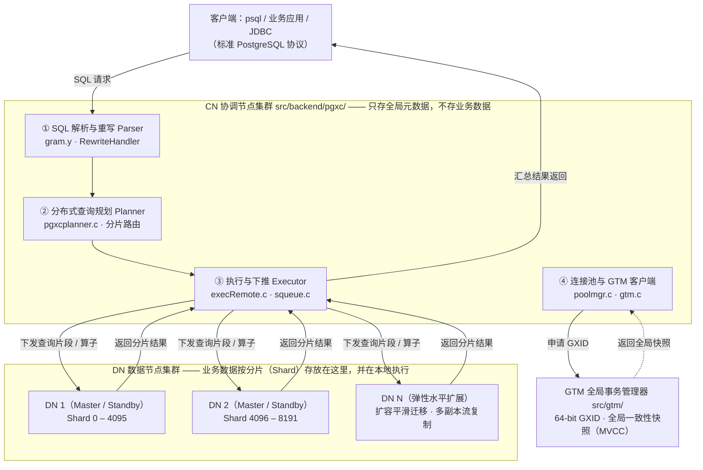
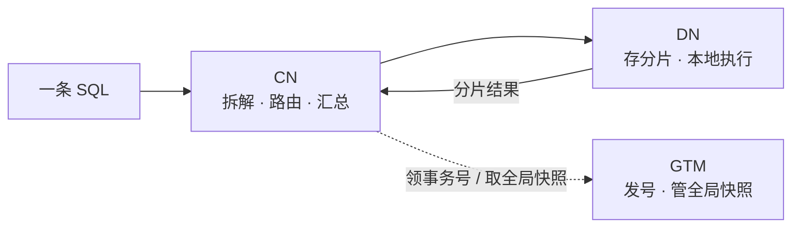

# 把 CN 讲明白 —— OpenTenBase 协调节点图解卡片

> **题目方向 2：把一个概念讲明白——数据库图解卡片**
> 概念：**CN（Coordinator Node，协调节点）**
> 小组成员：李佳锐 · 陈钰婵 · 柳雨涵　组号：21　完成日期：2026 年 11 月 7 日

---

## 一、一张图

> 上图用 Mermaid 绘制，GitHub 可直接渲染。同一张图的矢量高清版见 [`images/cn-flow.svg`](images/cn-flow.svg)，可本地打开的展示版见 [`cn-concept-card.html`](cn-concept-card.html)。

**看图先看这一点：** CN 不保存**实际的业务数据**，只保存系统的**全局元数据**——业务数据全部分片（Shard）放在 DN 里。所以 CN 干的只有四件事：**接单（解析）→ 排活（规划路由）→ 派活（下推执行）→ 收活（汇总结果）**。

---

## 二、简短说明：一句话讲清 CN

CN 是 OpenTenBase 集群的**协调节点**。业务永远连到 CN：客户端用标准 PostgreSQL 协议把 SQL 发给它，它先解析重写这条语句，再由规划器判断这条 SQL 涉及哪些分片（分片路由），把查询切成片段下推给对应的 DN 本地并发执行，最后把各 DN 返回的结果汇总成最终答案交回客户端。

CN 和 DN **共用同一套 schema**，所以 CN 手上没有业务数据也能完成解析与规划——它只保存系统的全局元数据（官方文档原话：「CN 上只存储系统的全局元数据，并不存储实际的业务数据」）。

CN 也不独自管理事务的全局秩序：全局事务号和一致性快照由 **GTM** 统一分配，CN 通过连接池模块（poolmgr.c / gtm.c）向 GTM 申请。

对外的 CN 不是一台机器，而是多台**位置对等**的协调节点组成的集群，每个 CN 都提供相同的数据库视图。

---

## 三、生活类比（只映射结构，不外推）

CN 像一个**项目经理**：

客户提需求（SQL 进来）→ 项目经理看懂需求（① 解析）→ 判断这件事要找哪些人做（② 规划路由）→ 把任务拆给对应的开发（③ 下推给 DN）→ 最后把大家的产出拼成完整交付（汇总结果）。

而「给每个任务编一个全局唯一号、保证大家看到的是同一份进度」（GXID 与全局快照）由另一个角色——**GTM**——负责，项目经理只是去它那里领号。

> **边界声明：** 类比到此为止。项目经理会不会请假、忙不过来怎么办，属于高可用问题，本卡片不涉及，也**不要从类比里推出任何关于故障或性能的结论**。类比的偶然细节不是技术事实。

---

## 四、常见误解

1. **「CN 是主库，业务数据存在 CN 上。」**
   不对。业务数据的分片存放在 DN 上（如 Shard 0–4095、4096–8191……）；CN 只保存系统的**全局元数据**，不保存实际的业务数据。

2. **「CN 是一台机器。」**
   不对。CN 是协调节点**集群**，多个节点位置对等，每个节点都提供相同的数据库视图。

3. **「CN 自己管事务。」**
   不对。全局事务号与全局一致性快照由 GTM 统一管理与分配，CN 只是 GTM 的客户端。

4. **「计算都得拿回 CN 做，DN 只负责存。」**
   不对。执行算子会下推到 DN 本地并发执行（算子并行下推、索引加速），CN 只收拢各分片结果。

5. **「CN 挂了数据就没了。」**
   不对。数据本就不在 CN 上；CN 是多节点对等部署，属于接入层，可独立水平扩展——这属于高可用话题，本卡片只指出「数据不在 CN」这一层，其余不展开。

---

## 五、谁管什么：CN / DN / GTM 的分工边界

一句话记法：**CN 是大脑（想怎么拆），DN 是手脚（真正干活，也存数据），GTM 是记账员（谁先谁后，得统一）。**

---

## 六、出处对照（每条表述 → 原文）

来源分三级：**［官方文档］** = OpenTenBase 官网快速入门；**［仓库 README］** = GitHub 仓库首页；**［架构图］** = 项目《分布式数据库内核架构全景图》（现场拍摄，见 [`images/architecture-slide.jpg`](images/architecture-slide.jpg)），仅用于补充实现细节。

1. **CN 不存业务数据，只存全局元数据** ——［官方文档］
   原文：「在功能上 CN 上只存储系统的全局元数据，并不存储实际的业务数据。」
   同义表述见［仓库 README］：「the CoordinateNode contains only metadata」「All user data resides in the DataNode」。

2. **用户的 SQL 总是发给 CN，由 CN 切分、下发、汇总；CN 与 DN 共用同一套 schema** ——［仓库 README］
   原文：「Users always connect to the CoordinateNodes, which divides up the query into fragments that are executed in the DataNodes, and collects the results.」
   同段另有：「The CoordinateNodes and DataNodes share the same schema.」

3. **CN 是多个位置对等的节点，视图一致** ——［官方文档］
   原文：「多个节点位置对等，每个节点都提供相同的数据库视图。」

4. **DN 存业务数据分片，并执行 CN 分发的请求** ——［官方文档］
   原文：「每个节点还存储业务数据的分片……DN 节点负责完成执行协调节点分发的执行请求。」

5. **GTM 管理集群事务信息与全局对象** ——［官方文档］
   原文：「GTM：全局事务管理器（Global Transaction Manager）负责管理集群事务信息，同时管理集群的全局对象，比如序列等。」

6. **CN 的四大模块与源码路径、CN↔GTM 的 GXID / 快照交互、算子并行下推、分片区间** ——［架构图］
   分别对应架构图 CN 区（src/backend/pgxc/：Parser / Planner / Executor / poolmgr.c·gtm.c）、CN↔GTM 箭头标注「申请GXID / 返回快照」、DN 区「分布式分片数据存储（Shards / Group）· 本地并发执行」「算子并行下推」及 DN 1「Shard 0–4095」/ DN 2「Shard 4096–8191」。

> **口径说明：** 架构图为现场翻拍，是第 6 条的唯一来源；其中「2PC 两阶段提交协调」「Oracle 兼容」「全局序列 / GTS」「GTM-Proxy」等细节本卡片**未展开**，也未作任何超出图面的推论。前 5 条均有官方文档或仓库 README 原文支撑。

---

## 七、参考链接

- OpenTenBase 官方开源仓库（README · Overview）：<https://github.com/OpenTenBase/OpenTenBase>
- OpenTenBase 官方文档 · 快速入门（三大模块 CN / DN / GTM 职责解读）：<https://www.opentenbase.org/blog/01-quickstart>

---

## 八、附件说明

- `README.md` —— 主交付物：图 + 说明 + 误解 + 出处对照（本文）
- `cn-concept-card.html` —— 展示版卡片，浏览器打开即为完整版式，可投屏或打印
- `images/cn-flow.svg` —— 数据流图矢量版，可放大不失真
- `images/architecture-slide.jpg` —— 架构图原始素材（出处：项目《分布式数据库内核架构全景图》，现场拍摄）
